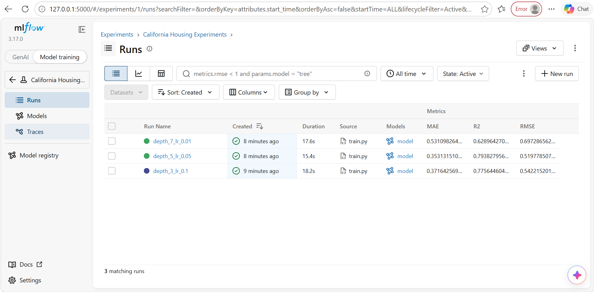

# ML Experiment Tracking with MLflow

## 1. Project Description

This project show how to track and compare ML experiments using MLflow.

The task uses the California Housing dataset to train a Gradient Boosting Regressor with three different hyperparameter configurations. MLflow records the parameters, evaluation metrics, and trained model artifacts for each run.

The goal is to identify the best-performing model using RMSE as the primary selection metric.

## 2. Dataset and Preparation

- Dataset: California Housing
- Training split: 80%
- Validation split: 20%
- Random seed: 42

The dataset is divided into training and validation sets to evaluate model performance on data not used during training-reference data-.

### Hyperparameter Configurations

Run 1: `depth_3_lr_0.1`
- `max_depth`: 3
- `learning_rate`: 0.1

Run 2: `depth_5_lr_0.05`
- `max_depth`: 5
- `learning_rate`: 0.05

Run 3: `depth_7_lr_0.01`
- `max_depth`: 7
- `learning_rate`: 0.01

## 4. Experiment Results

The following metrics were calculated on the validation dataset.

**Run 1: `depth_3_lr_0.1`**
- RMSE: 0.5422
- MAE: 0.3716
- R²: 0.7756

**Run 2: `depth_5_lr_0.05`**
- RMSE: 0.5198
- MAE: 0.3531
- R²: 0.7938

**Run 3: `depth_7_lr_0.01`**
- RMSE: 0.6973
- MAE: 0.5311
- R²: 0.6290

## 5. Best Model Selection

The best-performing configuration was **`depth_5_lr_0.05`**.

It achieved the lowest validation RMSE (approximately 0.5198),It also achieved the lowest MAE and highest R² among the three runs.

## 6. MLflow Tracking

MLflow was used to record the following for each run:

- Hyperparameters: `max_depth` and `learning_rate`
- Evaluation metrics: RMSE, MAE, and R²
- Trained model artifacts

The MLflow UI was used to inspect and compare the experiment results.

### 7. MLflow Results

The following screenshot shows the experiment runs and their evaluation metrics in the MLflow UI.

## 8. Conclusion

This task demonstrates the ML experiment tracking workflow:

**Train → Track → Compare → Select**

MLflow makes it possible to compare hyperparameter configurations using recorded metrics and model artifacts.